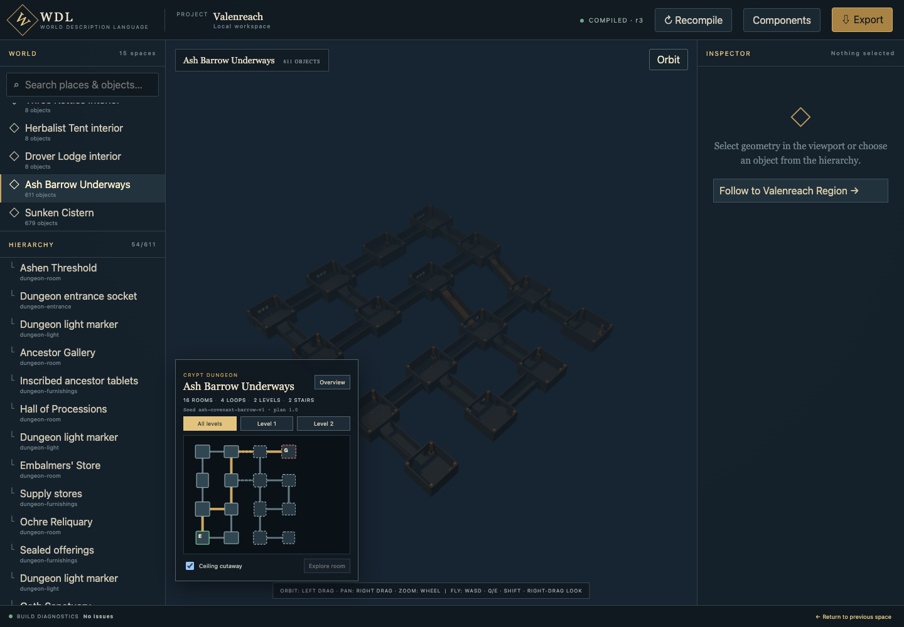
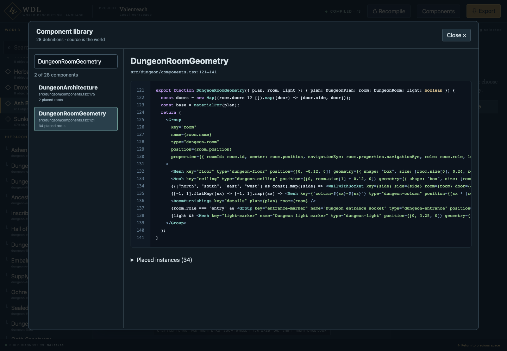

# Generative World Studio

Compose portable game worlds in JSX. Explore a component library, play it in a toy browser engine, and import native scenes and behavior into Godot .NET.

## Tell your agent

> Read AGENTS.md and docs/AGENT-QUICKSTART.md. Launch Valenfeld in the browser and Explorer, then integrate its scenes and behavior into my Godot .NET game using my player controller and inventory. Verify travel, the workshop gate, and save/restore.

Start with the [agent quickstart](docs/AGENT-QUICKSTART.md), [playable Valenfeld example](docs/VALENFELD.md), or [Godot integration recipe](docs/INTEGRATION.md). The example has eight houses, a market square, an inn, a cottage, and a workshop. Both game adapters consume the same compiled world and state contract.

```sh
npm ci
npm run game:spawn:web      # playable browser example
npm run game:spawn:explorer # inspect JSX components (separate terminal)
npm run game:spawn          # native Godot .NET example
npm run docs:dev            # searchable documentation at localhost:4173
```

**Previously WDL.** The product is now Generative World Studio. Existing `wdl` API names, source paths, commands, and this repository URL remain compatible. Agents read Markdown directly; the VitePress documentation build also emits `llms.txt`, `llms-full.txt`, and raw Markdown exports.



## Get started

Requires **Node.js 22.12 or newer** and npm. Blender and an AI coding agent are optional.

```bash
git clone https://github.com/Metatransformer/world-description-language.git
cd world-description-language
npm ci
npm run dev
```

Open [localhost:3000](http://127.0.0.1:3000). No account, database, or API key is required.

- Select a space or search for an object to inspect its properties and JSX source.
- Open **Components** for the complete searchable component library, syntax-highlighted definitions, and placed instances. Click a name in an object’s source chain to open that component.
- Orbit with the left mouse button, pan with the right button, and zoom with the wheel.
- In Fly mode, use WASD to move, Q/E vertically, Shift for speed, and right-drag to look.
- Follow a connection to enter an interior or dungeon, then follow its exit to return.
- Edit the world source to change the world. The workbench recompiles automatically and retains the last successful build if an edit fails.

## Make a dungeon

The dungeon maker builds seeded room graphs with branching routes, loops, door openings, corridors, stairs, and themed furnishings. Its room plans are data you can inspect before compiling geometry. Crypt and cistern kits demonstrate how the same authoring system can express different places.

Start in [`worlds/dungeons.tsx`](worlds/dungeons.tsx). For example:

```ts
import { createDungeonPlan } from "../src/dungeon/plan.js";

const plan = createDungeonPlan({
  seed: "my-ancient-crypt",
  theme: "crypt",
  roomCount: 16,
  levels: 2,
  loopCount: 2,
  corridorWidth: 4,
});
```

See the [dungeon guide](docs/DUNGEONS.md) for the plan, geometry, and extension points, and the [authoring guide](docs/AUTHORING.md) for JSX components and vocabularies.



## How it works

```text
TypeScript + JSX + vocabularies + explicit seeds
                    ↓
                 compiler
                    ↓
       world manifest + geometry + materials
              ↙                      ↘
     Three.js workbench         glTF scenes → Blender
```

Generative World Studio uses real React elements and function composition. It does not run a DOM renderer or a game update loop. Stable keys give authored objects identities, and seeded algorithms generate repeatable placements. Compilation does not call an LLM. Gameplay is described through properties and contracts for a consuming game to implement.

The [artifact contract](docs/ARTIFACT-CONTRACT.md) is independent of TypeScript and Three.js. Blender import and an initial Godot C# adapter are implemented; Unity and Unreal adapters are future work.

## Connect an AI agent through MCP

Start the workbench, then register the local server with Codex:

```bash
codex mcp add wdl -- node /ABSOLUTE/PATH/world-description-language/scripts/mcp.mjs
```

Restart the Codex chat to load the tools. Other MCP clients can use the same stdio command. `WDL_URL` defaults to `http://127.0.0.1:3000`.

Tools expose compilation, object queries, inspection and source provenance, navigation, selection, viewport capture, and export. Keep one workbench browser tab open for navigation and capture; viewer commands currently share a single local session. Ask your agent to edit JSX and recompile; the compiled manifest is an output, not the authoring source.

## Export to Blender

```bash
npm run compile
```

Artifacts appear in `.wdl/export/`: a `manifest.json` and a glTF scene per space, including embedded geometry and procedural textures. In Blender, choose **File → Import → glTF 2.0** and select a scene. Cross-space connections remain in the manifest.

To import and verify every scene automatically:

```bash
blender --background --factory-startup --python scripts/verify-blender.py -- .wdl/export
```

On macOS, the executable is commonly `/Applications/Blender.app/Contents/MacOS/Blender`. The script saves `valenreach.blend` with separate scenes and a verification report.

## Development and checks

```bash
npm run typecheck
npm test
npm run build
npx playwright install chromium
npm run test:e2e
```

Use `PLAYWRIGHT_CHANNEL=chrome npm run test:e2e` to test with installed Chrome. With the app running, `npm run test:mcp` exercises the MCP boundary. `node scripts/verify-workflow.mjs` also captures the viewport, edits JSX, checks identity stability, exports, and restores the original source; avoid editing that world concurrently.

For a production server, run `npm run build` followed by `npm start -- --hostname 127.0.0.1`.

This is an early local developer tool. World programs execute trusted local code. The demo uses original procedural geometry and materials; it includes small demonstration mechanics, not a production game framework.

Contributions are welcome: see [CONTRIBUTING.md](CONTRIBUTING.md). Released under the [MIT license](LICENSE).
