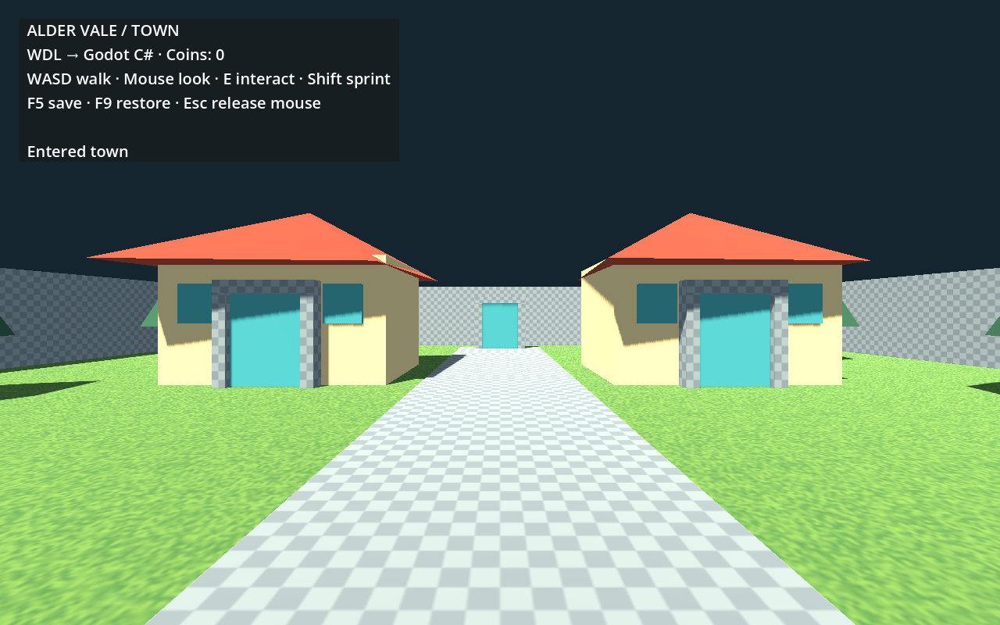

# Portable worlds: Godot C# and Three.js

The Alder Vale demo compiles JSX into five textured spaces: town, woodland, inn, cottage, and dungeon. Both engines execute the same state/action contract. Godot uses C#/.NET; no JavaScript runtime ships in the Godot game.



## Run the Godot demo

Requires Node 22.12+, dependencies installed with `npm ci`, the .NET SDK, and **Godot 4.7.2 .NET** (the SDK version used by this demo).

From the WDL repository:

```sh
npm run game:build
dotnet build examples/godot-dotnet/WdlDemo.csproj
godot --headless --path examples/godot-dotnet --editor --import
godot --headless --path examples/godot-dotnet -- --import-wdl
godot --path examples/godot-dotnet
```

Use your Godot .NET executable path if it is not on PATH. Open `examples/godot-dotnet/project.godot` in Godot to work in the editor. The enabled **WDL** dock provides Build Changed, Build All, Watch, and Import. Set its Node executable and WDL repository path if needed. Build the C# project again when the generated capability signatures change.

**Controls:** WASD walk, mouse look, Shift sprint, E interact, Esc release mouse, F5 save, F9 restore. Click to capture the mouse again. Walk forward through the town gate to the woodland, then through the far gate to the dungeon. The lever on the left opens the vault gate. Houses contain separate interiors and chests.

## Run the independent JavaScript engine

```sh
npm run game:build
npm run game:three
```

Open http://127.0.0.1:5174 and click **Explore world**. This is a separate Three.js runtime, not the workbench. It has its own native walking/interaction adapter, while importing the same behavior artifact. Save/restore uses browser storage; Godot uses its user-data folder.

## Authoring and state

Edit `worlds/rpg.tsx` for composition and `worlds/rpg-kit.tsx` for reusable components. State and behavior helpers live in `src/runtime`.

- JSX functions execute at build time; keys preserve identity within component structure.
- Props accept serializable state expressions and action references.
- A group with `properties.wdl.scope` declares private state. Descendants use `read("field")` and `action("name")`; the compiler resolves those references without manually authored object IDs.
- `read("field", "quest")` references a declared shared store. No parent should reach into another component's generated internals.
- `properties.wdl.bindings` currently supports boolean `visible` and `solid`.
- Visibility and interactions can belong to groups or meshes. Solid/collision bindings require mesh geometry and are rejected on groups.
- `properties.wdl.interact` declares an input action; the game decides how input is detected.
- Reducers support set, toggle, add, and conditional execution. Expressions support literals, state reads, and boolean not. Fields are typed scalar values in this first contract version.
- Expressions read the pre-action snapshot; reducer writes commit together before effects run. Effects execute in declaration order and dispatch success/failure actions. A store rejects new external actions while its effects are pending.
- Capabilities are developer-defined; inventory and travel belong to the demo, not to WDL.

Example: a lever receives an action prop, while a gate receives a state binding prop. They never exchange node IDs. A chest has local collected state and requests the game's inventory capability; it marks itself collected only after success.

The compiler validates reference targets, field types, action names, conditions, bindings, capability argument names/types, and duplicate persistence keys. Unsupported constructs fail before publication.

## Generated artifacts and typed capability hooks

`generated/manifest.json` and per-space glTF retain geometry, materials, world matrices, and provenance. `behavior.json` contains the resolved version-1 contract; `index.json` maps flat glTF node indices to compiler-generated handles. Consumers must not infer identity from engine-sanitized node names.

The build also emits `CapabilityBindings.cs` and `capabilities.ts`. The C# factory requires typed delegates for each declared capability. See the demo's call to `Wdl.Generated.CapabilityBindings.Create`. The TypeScript interface describes the same implementation contract. Missing implementations are rejected before interaction.

The importer generates native `.tscn` files for spaces and every component group or mesh, plus a `scenes.json` catalog mapping authored identities to scene paths. Component geometry is rebased to its own origin, with nested transforms preserved. Each exported root has a `WdlScene` script and a reduced contract containing its reachable stores/capabilities. Per-space and per-component fingerprints skip unchanged native imports.

## Use in another Godot .NET game

1. Copy `examples/godot-dotnet/addons/wdl` into your C# Godot project's `addons/wdl`.
2. Build the project's C# assembly and enable the WDL plugin.
3. Set the WDL repository and JSX entry in the dock. Builds target that Godot project's `res://generated`.
4. Import, then instantiate an exported space or component scene. Keep your own scripts in wrapper scenes.
5. Give independent instances distinct, durable `InstanceId` values. Call `Initialize(capabilities)` to create private runtime state, or `Bind(runtime)` to join an explicitly shared world runtime.
6. Dispatch public actions through `Runtime.Dispatch`, or let your input adapter call `Interact`. `WdlScene.Nearest` is an optional proximity-based interaction helper.

Build-time props remain in JSX. Runtime inputs are the declared stores/actions and registered capabilities; this initial version does not generate editable Godot Inspector controls for arbitrary JSX props. Changing compiled props means rebuilding. Engine-side placement of exported scenes is supported; editing generated internals is not a round-trip authoring workflow.

For a complete world, the demo keeps one runtime across scene changes. For separately placed components, `Initialize` owns independent state; explicitly sharing a runtime shares matching state handles. Geometry is imported as native meshes with static collision; the adapter updates collision layers from state bindings.

When exporting a standalone Godot game, include the generated JSON files in the export preset's non-resource include filters (for example `generated/*.json,generated/scenes/*.json`). Generate the native scenes before exporting. JSON contracts are read through FileAccess, so Godot cannot infer them as PackedScene resource dependencies.

## Build control

```sh
npm run game:build                 # changed dependencies only
npm run game:build -- --all        # force complete regeneration
npm run game:watch                # opt-in; Ctrl+C stops
npm run game:build -- --entry worlds/rpg.tsx --out /path/to/game/generated
```

Watch defaults off. Dependencies come from esbuild's actual imported input graph, compiler/runtime sources, and referenced texture assets. Builds stage compilation and export before touching successful outputs. Unchanged output bytes are not rewritten; the revision marker is published after artifact writes. Failed compilation/export preserves the previous output. Disk failures during publication are reported; this is not a transactional filesystem.

Restart the running game after rebuilding. Watch does not attempt live structural/state migration.

## Saves and limits

Persistent stores opt in with a unique `persistenceKey`. Ordinary JSX keys are not a promise of identity across source restructuring. Saves contain contract version, instance identity, durable store keys, and scalar values. Restore validates the complete persistent field/type layout before applying any changes. Saving/restoring during pending effects is rejected. Games own inventory, position, storage, and migration policy.

This first version deliberately excludes full React hooks, arbitrary JS reducer execution in Godot, action payload expressions, structured state fields, automatic migration, multiplayer, animation systems, and painting tools. Add portable operations to both runtimes together and extend the parity fixture. The Three.js demo uses axis-aligned collision suited to this world; Godot uses mesh collision. The player controller and physics are engine-specific, not part of the portable state contract.

## Verification

```sh
npm run typecheck
npm test
npm run game:verify
npm run game:three:build
dotnet build examples/godot-dotnet/WdlDemo.csproj
godot --headless --path examples/godot-dotnet -- --import-wdl
godot --headless --path examples/godot-dotnet -- --smoke-test
```

`game:verify` compares JS and standalone C# results for a shared sequence covering gate state, asynchronous failure/retry, duplicate suppression, instance isolation, and persistence. It also checks unchanged artifact mtimes. With the Three.js server running, `node scripts/verify-three.mjs` walks through town and woodland portals in Chrome. Set `PLAYWRIGHT_CHANNEL` to another installed Playwright browser channel when needed.

Validated locally: TypeScript checking; 21 unit tests (2 optional MCP checks skipped); Next.js production build; all 6 workbench browser cases (the Windows component-search case passed after path normalization); JS/C# parity and build-failure checks; Three.js production build and walking/gate/chest browser smoke; Godot .NET build with zero warnings; native scene import, unchanged timestamps, independent placed components, gameplay, persistence, and rendered preview. Standards and spec reviews have no unresolved findings.
