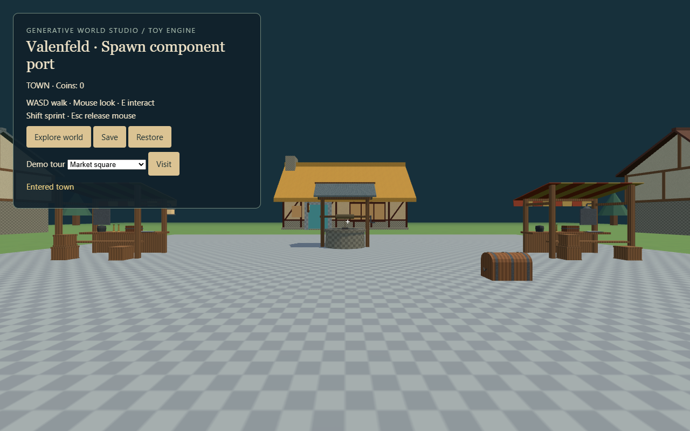
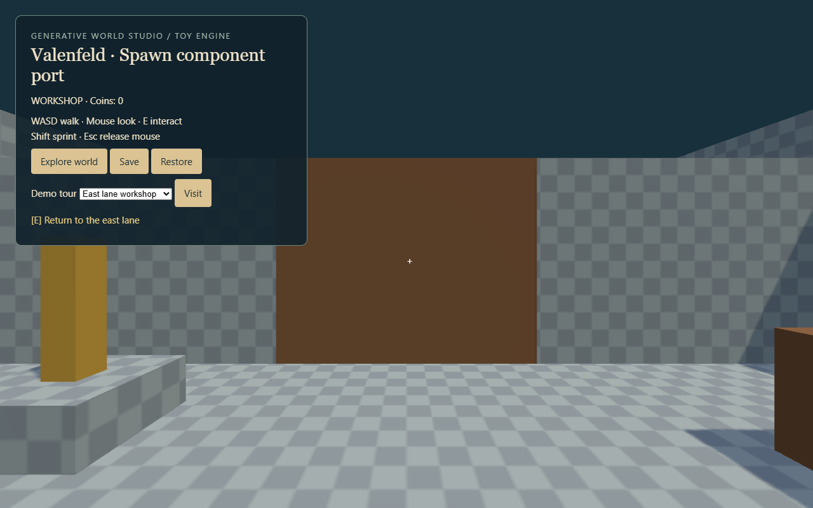
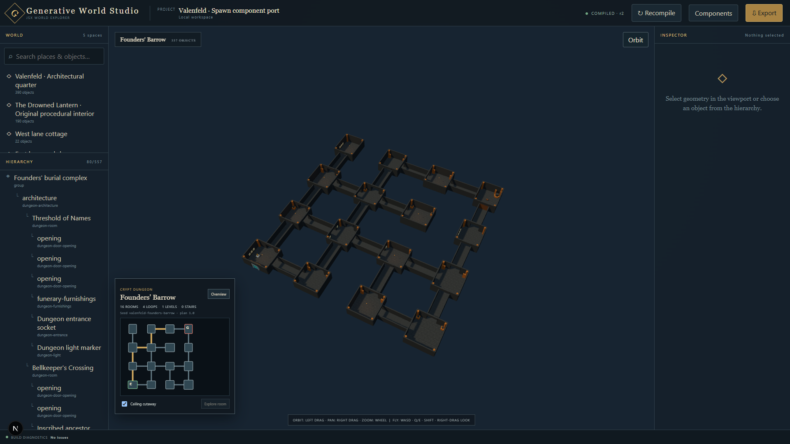

# Valenfeld: playable integration example

Tell your agent: **“Read docs/AGENT-QUICKSTART.md, launch Valenfeld, and show me its component library and Godot adapter.”**

[Play the hosted demo](https://metatransformer.github.io/world-description-language/demo/) immediately, or run it locally below. The hosted demo uses the toy browser engine; the Godot adapter is available in the repository.

```sh
npm ci
npm run game:spawn:web
```

The launcher builds the JSX and serves the toy Three.js engine at http://127.0.0.1:5174. Click Explore world for mouse capture. WASD walks, mouse looks, E interacts, Shift sprints, and Escape releases the mouse. Save/Restore buttons preserve inventory, position, and portable state. The Demo tour picker provides shortcuts between spaces without resetting state.

## Explore the example



| Space | What to try | Source |
| --- | --- | --- |
| Town | Eight houses, market stalls, well, chest; cyan doors lead into buildings | `worlds/spawn-demo.tsx` |
| Drowned Lantern | Imported procedural inn with furnishings, rooms, and a collectible chest | `worlds/spawn/components.tsx` |
| West lane cottage | Furnished room, independent chest, return door | `worlds/spawn/interiors.tsx` |
| East lane workshop | Operate the lever, walk through the open storeroom gate, collect the chest | `worlds/spawn/interiors.tsx` |

The inn entrance is north of the market square. Cottage and workshop doors are on the west and east lanes. Only these three buildings have connected interiors; the remaining houses demonstrate architectural variants. The new cottage/workshop are demo designs, not reconstructions of the original Spawn rooms.

In the workshop, the lever and gate share a private store through action and state-expression props. Each chest has independent persistent state and calls `inventory.grant`. Doors call `world.travel`. Those two capabilities are provided by each engine, while the JSX and contract are shared.



## Founders' Barrow



The town's north-east portal leads to a sixteen-room crypt assembled from the shared dungeon kit. Four looping routes connect burial chambers, galleries, supply alcoves, and the Founders' Vault. The entrance lever releases every vault seal; the heirloom chest uses the same portable inventory capability as the town chests.

Choose Founders' Barrow in the toy engine's tour picker to start at the entrance. In Explorer, select the dungeon and use Overview with Ceiling cutaway to inspect the layout from above. It uses one elevation for the toy controller; floors, walls, columns, and furnishings carry collision into both engines. Edit `worlds/spawn/dungeon.tsx` for the authored plan, room names, and interactions.

## Inspect and run natively

```sh
npm run game:spawn:explorer
npm run game:spawn
npm run game:spawn:editor
```

Explorer at http://127.0.0.1:3000 provides object/source inspection. Godot requires the .NET edition matching `examples/godot-dotnet/WdlDemo.csproj` and an appropriate .NET SDK; set `GODOT_BIN` when discovery cannot find it. The Godot launcher builds C#, imports native scenes, and opens the game. Godot uses F5/F9 for save/restore.

## Follow a component through the build

1. `ValenfeldHouses` composes `House` with `Storey`, `Roof`, `Windows`, and `Chimney` props.
2. `spawn/capture.ts` adapts the snapshotted procedural generator to indexed meshes, materials, and separate collision proxies.
3. `scripts/build-game.ts` emits the manifest, glTF, behavior contract, node index, and typed capability bindings.
4. Three loads those files directly. Godot's `SceneImporter` generates native `.tscn` spaces and components plus the `scenes.json` catalog.
5. `WdlScene` binds native nodes to the C# state interpreter. Your game supplies capability delegates and chooses when to dispatch interactions.

Use [the Godot integration recipe](INTEGRATION.md) to replace the example player/inventory with your own systems. See [SPAWN-PORT.md](SPAWN-PORT.md) for material substitutions and source provenance.

## Verify changes

```sh
npm run typecheck
npx vitest run tests/spawn.test.tsx
npm run game:spawn:build
node scripts/verify-valenfeld.mjs
```

The browser verification requires the toy server already running. After native build/import, run Godot with `--headless --path examples/godot-dotnet -- --smoke-spawn` to exercise native scenes and behavior. Use the executable path from `GODOT_BIN` if `godot` is not on PATH.
